<div align="center">

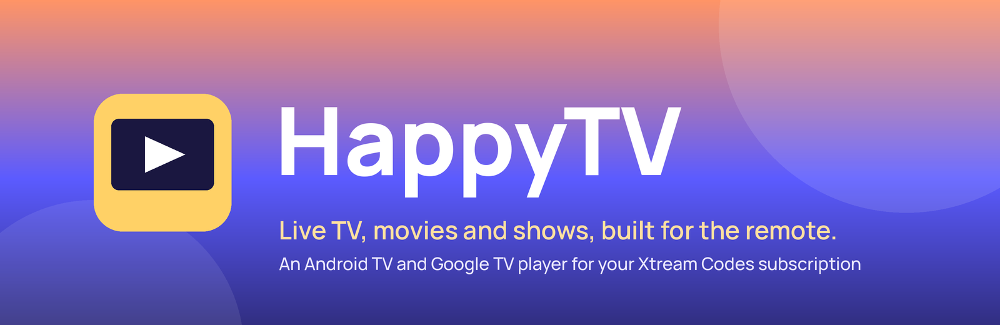

<br>

[](https://github.com/rsalinger/HappyTV/releases)


[](LICENSE)

**A warm, fast, remote-first player for your Xtream Codes subscription.**<br>
No ads. No telemetry. No HappyTV servers. Your sign-in never leaves the TV except to reach your own provider.

</div>

---

HappyTV started as a personal project: one household, one living room, one remote, and a provider with more than 20,000 channels. The goal was a TV app that a grandparent can use without a lesson and that never makes anyone wait. It signs in to your Xtream Codes provider, keeps a local copy of the channels, movies, shows and TV guide, and plays them.

It is built for the D-pad. If the remote cannot reach it, it does not exist.

> [!IMPORTANT]
> HappyTV is a player. It hosts, sells and provides **no content** of any kind. You bring your own Xtream Codes subscription that you are entitled to use. See the [legal note](#legal-note).

## Contents

- [Take the tour](#take-the-tour)
- [Built for large channel lineups](#built-for-large-channel-lineups)
- [Privacy](#privacy)
- [Tech stack](#tech-stack)
- [Build from source](#build-from-source)
- [FAQ](#faq)
- [Legal note](#legal-note)
- [License](#license)

## Take the tour

Every screenshot is the real app running on a made-up catalog of invented channels, movies and shows.

### A dashboard with big tiles

Live TV, Movies and Shows sit up front as large tiles, with the TV guide and Settings below. Each tile shows its own refresh progress or an "Updated" stamp, so you can see at a glance that your lists are fresh. A small sun or moon button at the top right switches between dark and light themes.

<p align="center">
  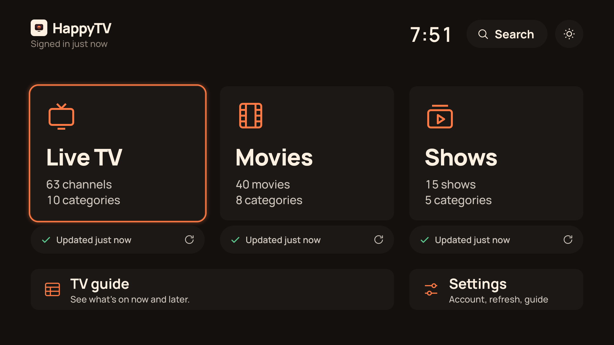
</p>

### Live TV and the guide, together

Live TV and the guide are one screen. Switch between a guide grid and a plain channel list with the header toggle; HappyTV remembers your choice. The guide shows a Now line, day tabs and a program details dialog that leads to watching live or starting a replay where the channel supports it.

<p align="center">
  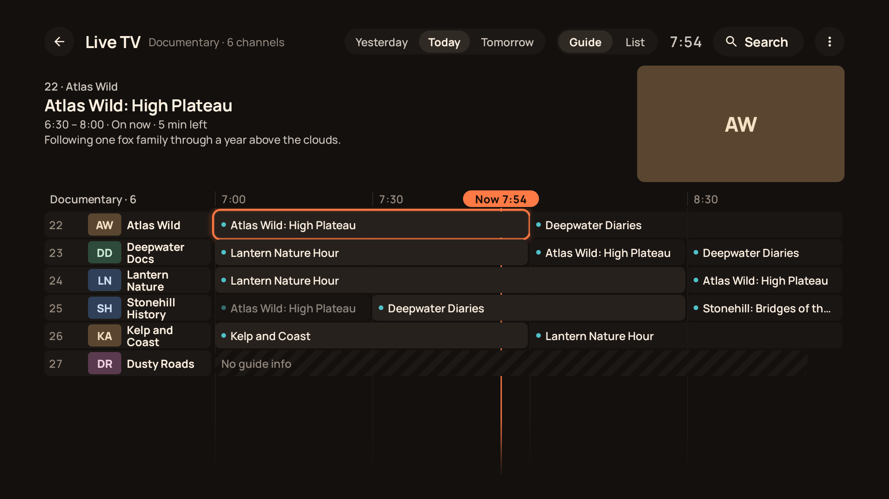
</p>

### The category rail, the channel list and the preview

Entering Live TV loads nothing until you pick a category, so it opens instantly even with a huge channel list. The fold-out category rail keeps Favorites and Recently watched pinned at the top. Press OK or Right on a category to load it and fold the rail away; press Left from the first column, or Back from the content, to fan it out again.

<p align="center">
  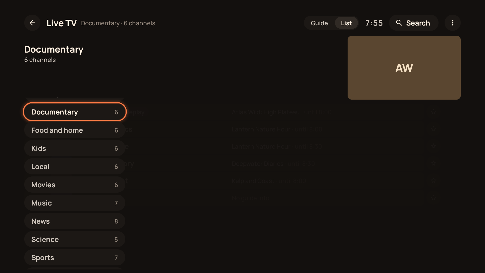
  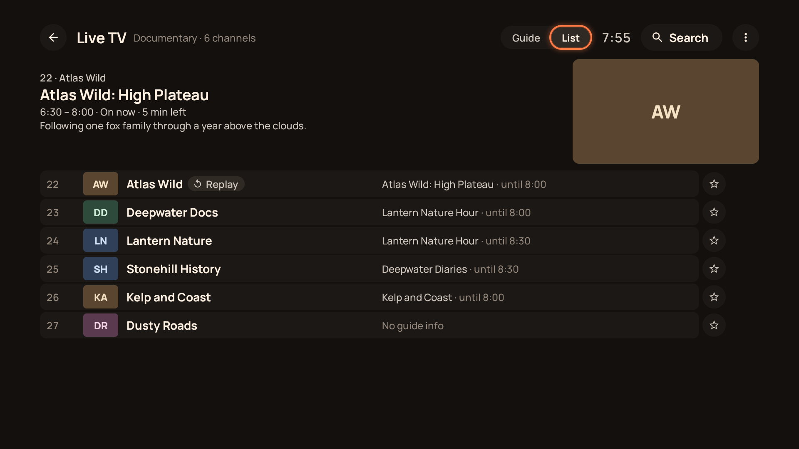
</p>

Back from full-screen live playback does not stop the show. It shrinks the video into a preview inside Live TV and keeps it playing while you browse.

<p align="center">
  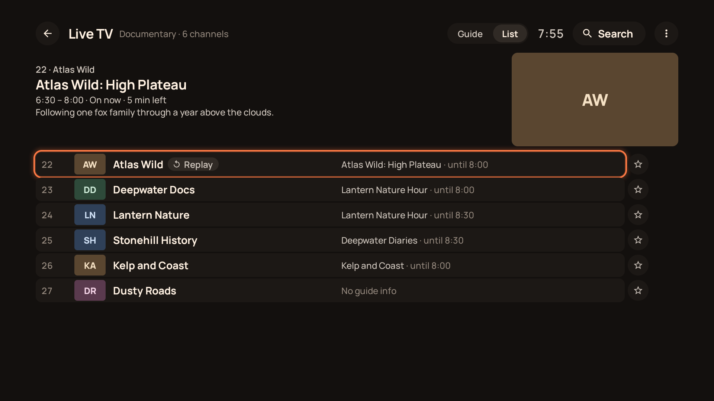
</p>

### The guide, forward in time

Press Right past the edge of the two-hour window and the guide moves forward in half-hour steps, up to the end of tomorrow. Back returns to now.

<p align="center">
  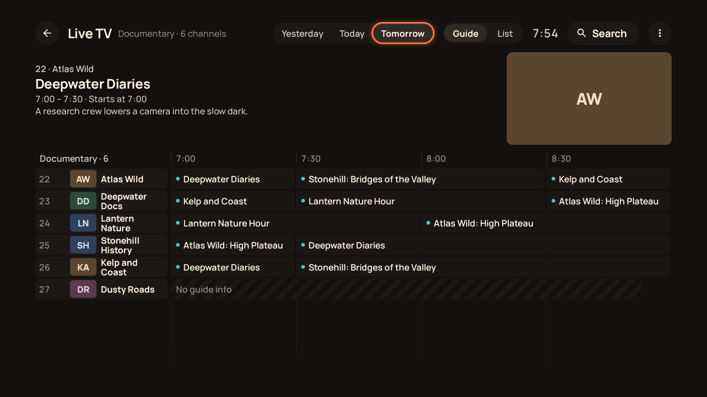
</p>

### Favorites and recently watched

Long-press OK on a channel, category, poster or dashboard tile to open its menu: star it, hide it, or refresh it. Starred channels live in Favorites and the last channels you watched are in Recently watched, both pinned at the top of the category rail. Hidden items can be shown again from Settings.

### Movies and Shows

Movies and Shows are one screen each, with the same fold-out rail and a seven-column poster grid. Categories lead with Continue watching when something is in progress. Posters load as you scroll.

<p align="center">
  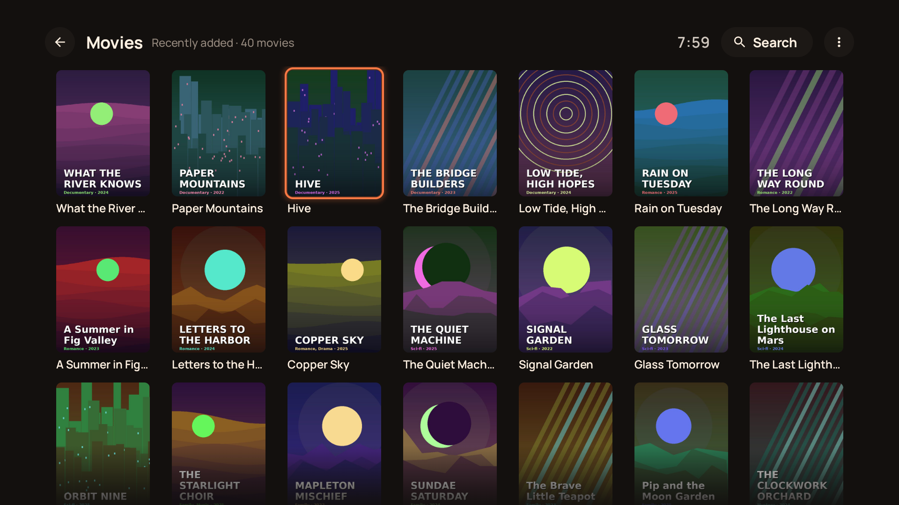
</p>

OK on a poster opens its details: poster, backdrop, plot, cast and a Play or Resume button. Shows add a row of season chips and the episodes of the season you are on, and the main button reads like "Resume S2 E3" or "Play S2 E4".

<p align="center">
  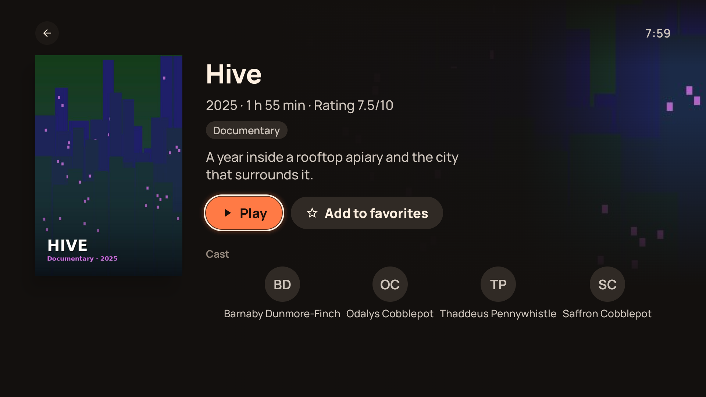
  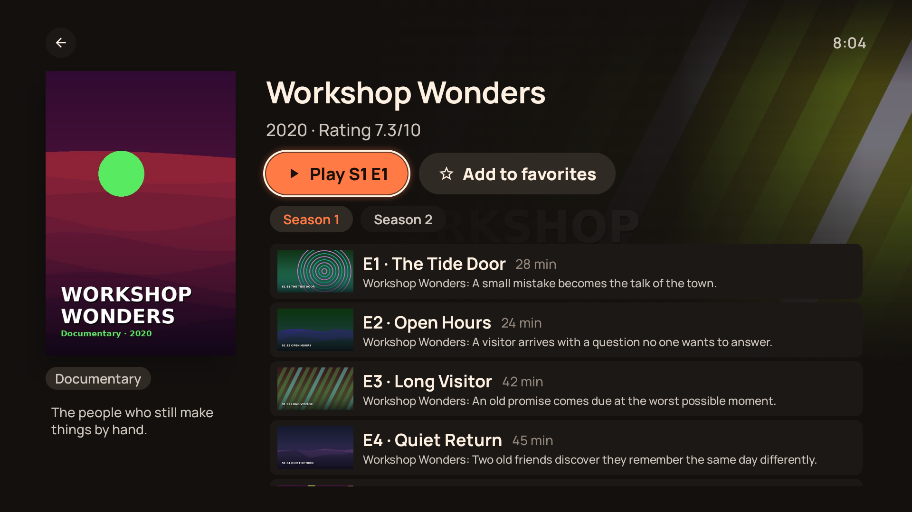
</p>

### Pick up where you left off

Stop a movie or an episode halfway and HappyTV remembers. The next time, the button says Resume, with Start over beside it, and the movie or show appears under Continue watching.

<p align="center">
  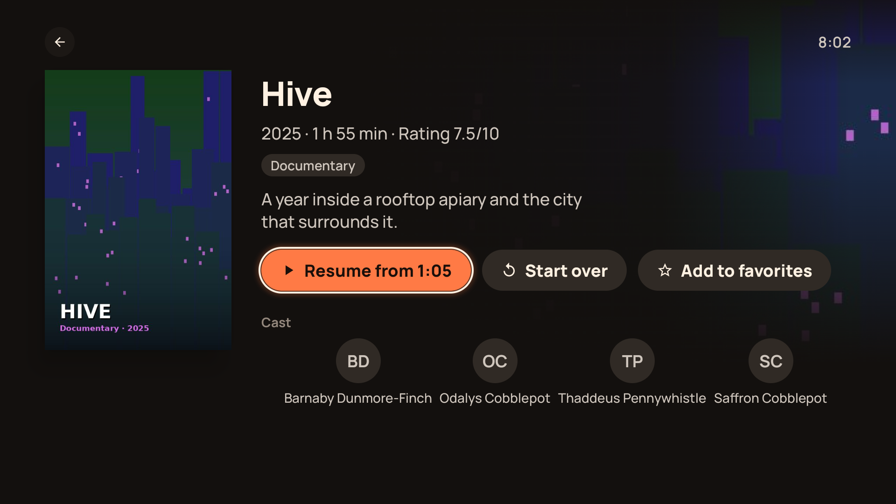
</p>

### A player that gets out of the way

Built on Media3 and ExoPlayer, with live, movie and replay modes. The controls come up with OK and go away by themselves. OK only reveals them and never pauses, so you can open program info or pick a subtitle without stopping the show. Live shows Now and Next; a track panel lists audio and subtitles.

<p align="center">
  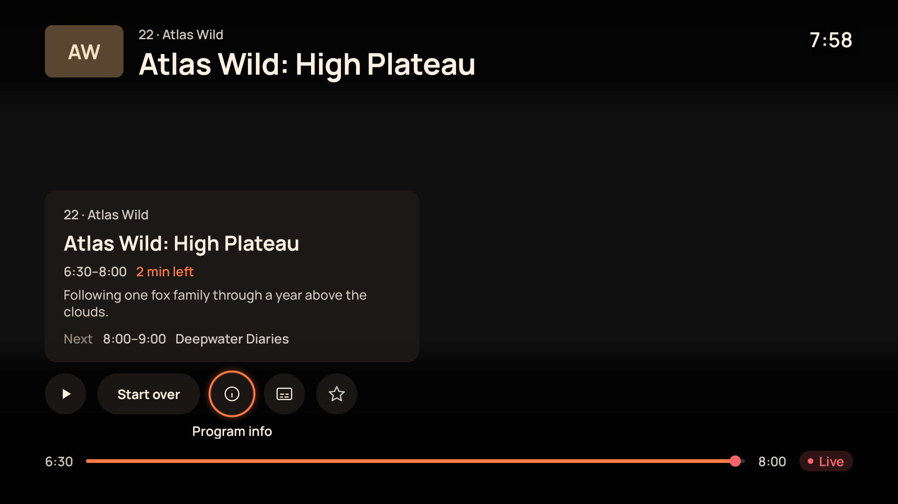
  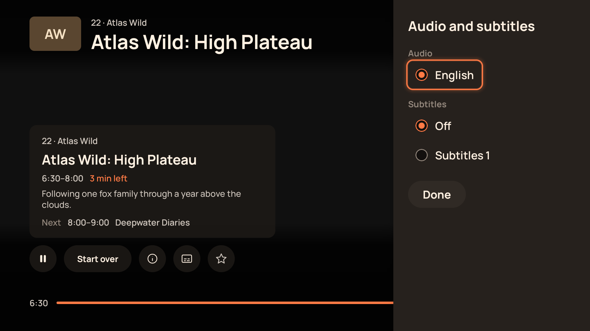
</p>

### Search

Search opens as an overlay from the dashboard or any browse screen. On Live TV, Movies and Shows it searches that type. Results appear after a short pause, grouped as channels, movies and shows, and every word you type has to match. It uses the system keyboard.

<p align="center">
  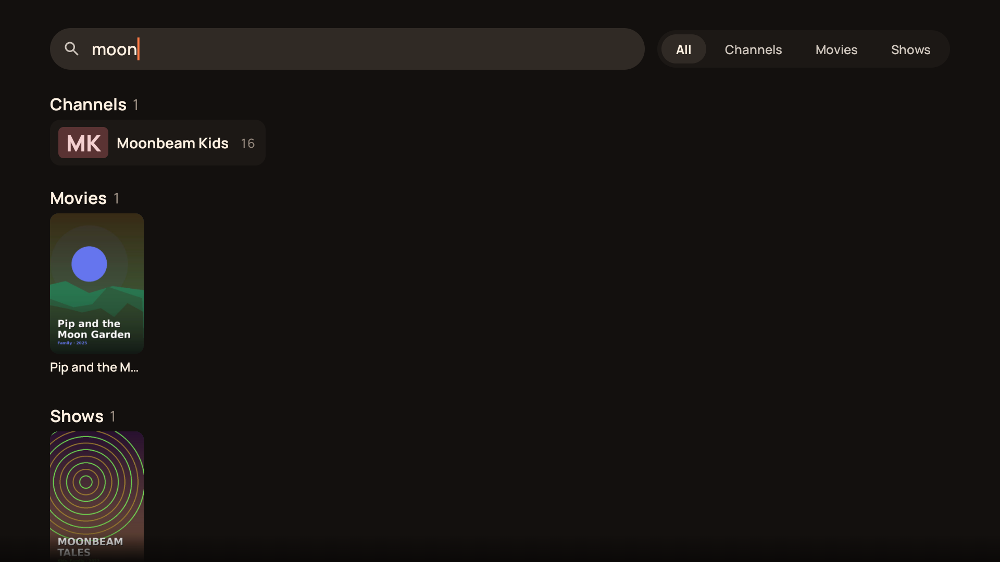
</p>

### Settings

One screen, two panes: sections on the left, that section's rows on the right. Account, Refresh, Live TV, Guide, Hidden items, Player and About. Every change saves immediately; there is no Save button.

<p align="center">
  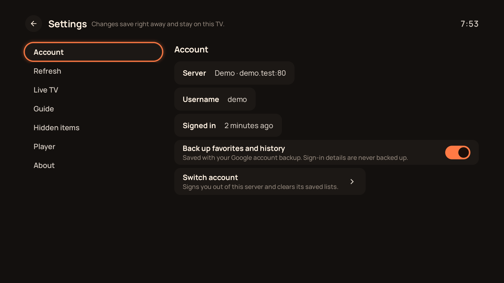
</p>

### Light and dark

Dark is the default, tuned for a living room at night. Light is warm paper and espresso text, with a deeper orange accent so the focus ring stays easy to see. The player and anything over video stays dark in both.

<p align="center">
  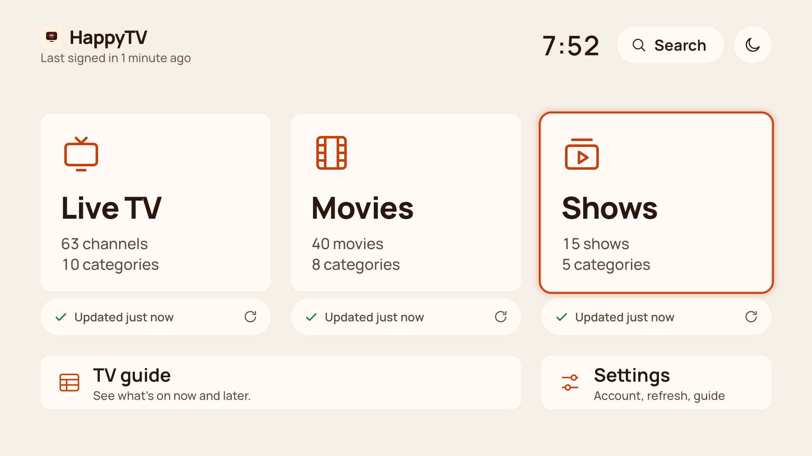
  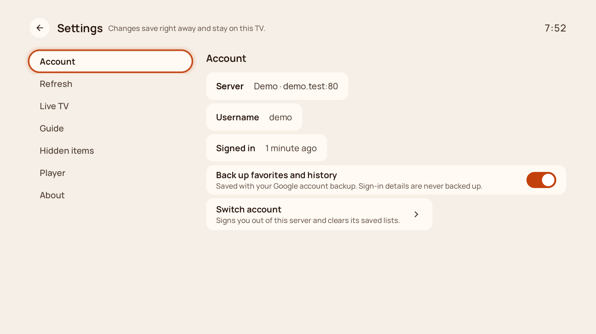
</p>

### Built for the D-pad and the whole family

- **Big tiles** and one clear focus ring: a 4 px orange outline with a soft glow that appears instantly. A focused item never grows, shrinks or moves.
- **Hold OK** on a tile, channel or poster for its menu. Back always returns to the previous layer and puts focus back where you were.
- **Plain words.** Channels, movies, shows, guide, replay, and a star for favorites. No jargon, no exclamation points.
- **Sign-in that explains itself.** A server typed without a scheme uses HTTPS. Plain HTTP asks for your consent first.

<p align="center">
  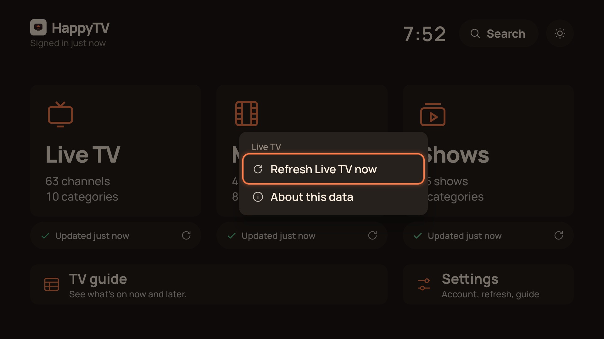
  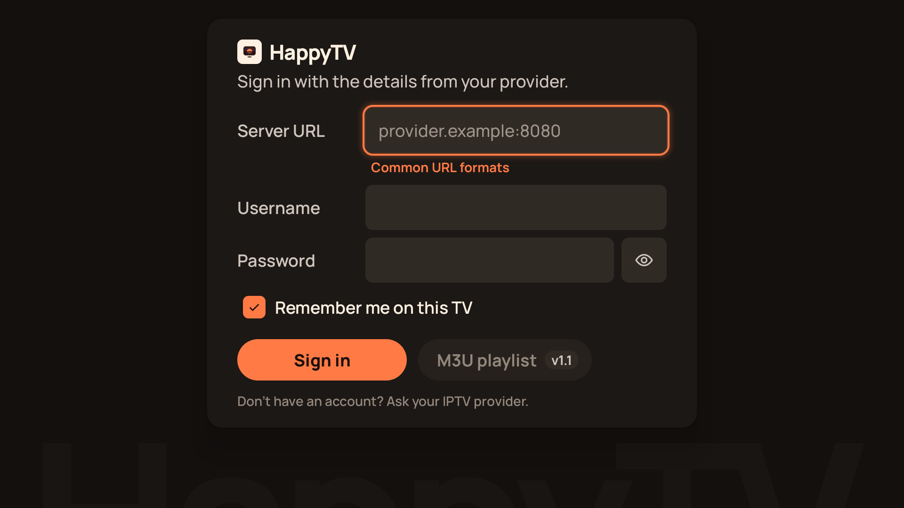
</p>

## Built for large channel lineups

Providers can have tens of thousands of channels and over a hundred thousand movies. HappyTV is written around that.

- **Category first.** Live TV loads no channels until you choose a category, so it opens immediately.
- **Virtualized and paged lists.** Only what is on screen is composed, and posters and channels load in pages as you scroll.
- **Chunked refresh.** Catalog lists are decoded as a stream and synced in chunks of 1,000 rows, each in its own short database transaction, and rows the provider dropped are removed only after the whole list arrived. A failed download removes nothing. On a low-end Chromecast, peak Java heap during refresh stays around 24 to 32 MB.
- **Guide import in stages.** The XMLTV guide is streamed, parsed in chunks and then promoted in one step, so the guide on screen never goes half empty during a refresh.
- **Work off the main thread.** Database and network work never block the remote.
- **Cached art.** Channel logos load over HTTPS and are cached as decoded bitmaps.

## Privacy

- **No ads, no telemetry, no analytics, no accounts.** HappyTV has no server of its own.
- **No HappyTV cloud.** Your lists, favorites, history and settings live on the TV. HappyTV has no server to send them to.
- **One optional backup, through Android.** "Back up favorites and history" (Settings, Account; on by default) puts one small file in the TV's own Android backup, which Google stores in the Google account the TV is signed in to. A reset or replacement TV can then bring back your favorites, hidden items, recently watched, resume points and non-secret settings after you sign in again. The file names items only by the provider's ID numbers. It never contains your server address, username, password or any link, and the sign-in details and the rest of the app's data are excluded from backup entirely. Turn the switch off and the next backup carries nothing from HappyTV.
- **Credentials are encrypted** with a key held in the Android Keystore (EncryptedSharedPreferences). They are used only to talk to your provider.
- **Plain HTTP needs your consent.** A server typed without a scheme uses HTTPS. If you really need plain HTTP, HappyTV asks first and says why.
- **No picture-in-picture, no background playback.** Home and screen-off stop playback.

## Tech stack

| Area | What |
| --- | --- |
| Language | Kotlin 1.9 |
| UI | Jetpack Compose for TV (Compose BOM 2024.05) |
| Playback | Media3 1.3 (ExoPlayer, HLS) |
| Storage | Room 2.6 (exported schemas, tested migrations), DataStore, EncryptedSharedPreferences |
| Background work | WorkManager |
| Network | OkHttp, Retrofit, kotlinx.serialization |
| Build | Android Gradle Plugin 8.5, Gradle 8.7, Java 17 |
| Targets | minSdk 23, targetSdk 34 |

### Where things live

```
android/app/src/main/java/com/rysal/happytv/
  data/            Room, DAOs, settings, background work
  data/network/    Xtream API, repository, refresh coordinator
  data/guide/      XMLTV fetch, streamed parse, staging and promotion
  security/        encrypted credential store, consent stores
  ui/              theme, focus helpers, sign-in, dashboard,
                   Live TV and rail, guide, Movies and Shows, player, search, settings
  perf/            timing
android/app/src/test/  unit and Robolectric tests mirroring the main tree
```

The design rules (colors, type, focus, copy) are written into the theme and the code under `ui/theme`.

## Build from source

You need JDK 17 and the Android SDK (platform 34). Android Studio works, and so does the command line. The Android app lives in `android/`, and the repository is laid out so that other platforms can sit beside it later.

```bash
git clone https://github.com/rsalinger/HappyTV
cd HappyTV/android

# Tell Gradle where the Android SDK is (or let Android Studio write local.properties for you)
export ANDROID_HOME=/path/to/Android/Sdk

# Build and run the unit tests
./gradlew :app:testDebugUnitTest :app:assembleDebug

# Install on a TV or emulator that has adb access
adb install -r app/build/outputs/apk/debug/app-debug.apk
adb shell am start -n com.rysal.happytv/.ui.login.LoginActivity
```

On a small machine, limit Gradle's appetite:

```bash
./gradlew :app:testDebugUnitTest :app:assembleDebug --max-workers=2 -Dorg.gradle.parallel=false
```

### Build types

| Type | Command | Notes |
| --- | --- | --- |
| debug | `./gradlew :app:assembleDebug` | No signing needed. Good for trying things out. |
| benchmark | `./gradlew :app:assembleBenchmark` | Minified with R8, not debuggable, signed with the debug key. Use this one to judge speed. |
| release | `./gradlew :app:assembleRelease` | Minified with R8. Needs your own signing key. Without one it builds unsigned, so check the signature before you install it. Setting `HAPPYTV_RELEASE_CERT_SHA256` makes a release build refuse to start if it was re-signed with a different key; without it there is no check. |

Release signing reads `HAPPYTV_KEYSTORE_PATH`, `HAPPYTV_KEYSTORE_PASS`, `HAPPYTV_KEY_ALIAS` and `HAPPYTV_KEY_PASS` from your Gradle user properties or from environment variables of the same names. Keep your keystore out of the repository.

Always use `adb install -r`. Uninstalling or clearing data signs the app out and erases favorites and history on that device.

## FAQ

### Where do the channels, movies and shows come from?

From your own Xtream Codes provider. HappyTV ships with no content and no provider. You sign in with the server address, username and password your provider gave you.

### Which devices does it run on?

Android TV and Google TV devices running Android 6 (API 23) or newer, controlled with the D-pad remote. It is developed on Chromecast devices. A phone layout is not built.

### Will it play 4K and HEVC?

If your device can decode it. The player uses the device's own decoders. When one cannot play a stream, HappyTV shows a card that says so and puts "Back to channels" under your thumb.

### Is there picture-in-picture?

No. Back from full-screen live TV shrinks the video into a preview inside Live TV and keeps it playing. Home and screen-off stop playback. In Settings, Player, "Back while watching" can stop playback on Back instead.

### Does it send anything to you or anyone else?

Not to us: there is no analytics, no crash reporting and no HappyTV account. Network traffic goes to your own provider, plus the guide and artwork addresses it hands out. The one other thing is Android's own backup: while "Back up favorites and history" is on, a small file of favorites, history and settings goes to the Google account the TV is signed in to. It holds no sign-in details. See [Privacy](#privacy).

### Can I use more than one provider?

One signed-in account at a time. Settings has Switch account, which asks first, because it clears favorites, history and hidden items for the old account.

### Is it on the Play Store?

No. You build it yourself from this repository.

### Can I help?

Issues are welcome, especially a clear description and the device you are using. Do not paste your provider address, username, password or stream links into an issue.

## Legal note

HappyTV is a media player. It does **not** host, provide, sell, stream or index any channels, movies, shows, guide data or other content, and it is not affiliated with any provider. It plays what your own subscription gives it access to.

You are responsible for using HappyTV only with a subscription and content you are legally entitled to use, and for following the laws and terms that apply to you. The authors do not condone piracy.

## License

HappyTV is free software, released under the [GNU General Public License v3.0](LICENSE). You can use, study, change and share it, and if you share a modified version, you share it under the same terms.

The app bundles the [Manrope](https://github.com/sharanda/manrope) typeface, which is licensed under the SIL Open Font License 1.1.

<div align="center">

<sub>Made for one living room, shared with yours.</sub>

</div>
